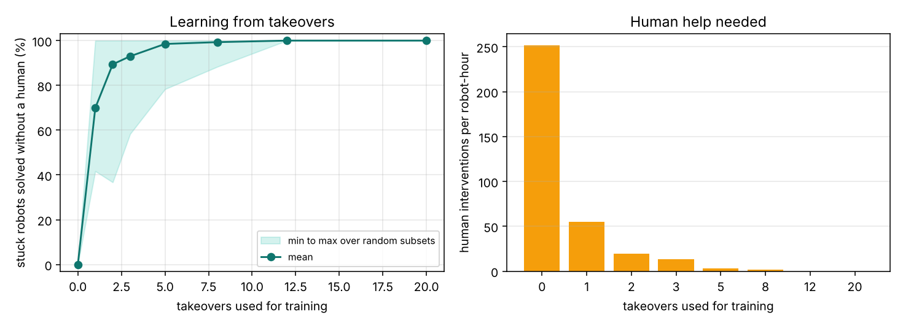

# Mini Aktoria

A small simulation of **remote robot operation with human takeover, and learning from every takeover**.

Robots drive themselves until they get stuck. A remote human operator takes control through a web console, solves the problem, and hands control back. Every takeover is saved as structured data, and that data is used to train a policy that solves the same problem on its own the next time. The console measures how much human help the fleet still needs.

> Independent student project, inspired by the idea of a teleoperation layer for robots. Not affiliated with any company. Everything runs in simulation on one laptop, no hardware needed.

**Demo video:** _(add link here)_

---

## The idea in one picture

```
 robots drive  ->  get stuck  ->  human takes over  ->  takeover is logged
      ^                                                        |
      |                                                        v
 fewer humans needed  <-  robot tries the learned policy  <-  policy learns from the log
```

## What works today

- **Fleet of 3 simulated robots** (2 types) with a randomly placed wall each run
- **Autopilot** that drives to the goal and detects when it is stuck
- **Help queue:** stuck robots wait there, the operator picks one
- **Operator console** in the browser: take over with the arrow keys, hand back to the autopilot
- **Adapter layer:** a wheeled robot (forward/turn) and a differential-drive robot (left/right wheels) are driven from the same console. The console shows each robot's native command.
- **Live latency** (average, last, p95) and a **network simulation** (Good, Slow 200 ms, Bad 500 ms + 10% loss, Down)
- **Safety stop:** if no operator command reaches a robot for 0.5 s, it stops by itself
- **Takeover log** in SQLite, exported as `episodes.jsonl`
- **Learning from takeovers:** a policy trained on the logged takeovers gets stuck robots past the wall without a human (see results below)
- **Fleet stats:** takeovers, robots solved by the learned policy, human interventions per robot-hour, % of time robots need no human, operator busy %, average queue wait

## Run it

```
git clone https://github.com/kanush03/mini-aktoria.git
cd mini-aktoria/backend
pip install -r requirements.txt
python -m uvicorn server:app
```

Open http://localhost:8000 (on Windows, use `py` instead of `python` if `python` is not found).

**A 60-second tour**

1. Three robots drive and each gets stuck at its own wall. They appear in the **Help queue**.
2. Click **Take over** and steer with the arrow keys: turn left until the robot points a little past straight up, drive above the wall, turn right, drive past it, then **Hand back**.
3. Click **Slow** or **Bad** under Network and steer again to feel the delay. Click **Down** while holding a key to see the safety stop.
4. Do three or more takeovers, click **Learn from my takeovers**, switch on **Learned assist**, then **Restart demo**. Stuck robots now try the learned policy first, and the "human takeovers" counter stays low.

## Learning from takeovers

**Method.** Behaviour cloning with a k-nearest-neighbours policy (`backend/learning.py`). For a stuck robot, find the logged situations that look most like the current one (position relative to the wall, heading) and repeat what the operator did there. The policy outputs a generic forward/turn command, and each robot's adapter turns it into its own controls, so a policy learned from one robot type works on the other.

**Evaluation** (`python evaluate.py`). For each number of training takeovers, train on that many, then drop robots into 60 fresh random worlds they have never seen, let them get stuck, and let the learned policy try. A world counts as solved if the policy gets the robot past the wall and the autopilot then reaches the goal. If not, a human is needed. Each size is repeated on 30 random subsets of the demonstrations.



| Takeovers used for training | Stuck robots solved without a human | Human interventions per robot-hour |
|---:|---:|---:|
| 0 | 0% | 251.8 |
| 1 | 69.9% (min 41.7, max 100) | 55.2 |
| 2 | 89.4% | 19.3 |
| 3 | 93.0% | 13.1 |
| 5 | 98.5% | 3.1 |
| 8 | 99.3% | 1.6 |
| 12 | 100% | 0.0 |

Results are from `docs/learning_results.json`. Robot-hours are simulated time.

**How to read this honestly**

- The demonstrations in this experiment come from a **scripted operator** (`backend/scripted_operator.py`), not a person. It follows the routine a human uses, with random timing, thresholds and hesitations, so the experiment is reproducible. Takeovers you do in the console go through the same pipeline (**Learn from my takeovers**), but I have not measured the learning curve on human data.
- The task is deliberately small: one wall, with a gap above and below. The result shows that the loop works and is measurable, not that this method would work on a real robot.
- The policy is told where the wall is and how tall it is, like a perception module would. It does not see pixels.
- A human takeover is assumed to cost as much time as the scripted operator needs; the learned policy gets 12 s before a human is asked.

**Reproduce**

```
cd backend
pip install -r requirements-dev.txt
python evaluate.py          # about a minute, rewrites docs/learning_results.json and the chart
python train.py             # retrain backend/model.json (the model the console loads at start)
python train.py --from-db   # train on your own takeovers from takeovers.db
python -m pytest            # 13 tests, about 20 s
```

## How it works

```
 Simulated robots          Adapter layer             Operator console (browser)
┌────────────────┐     ┌──────────────────┐      ┌──────────────────────────┐
│ Wheeled robot  │◄───►│ from_drive()     │◄────►│ help queue, keyboard     │
│ Diff-drive bot │     │ send_command()   │  WS  │ latency, network sim     │
└────────────────┘     │ step()           │      │ stats, learning panel    │
        ▲              └──────────────────┘      └──────────────────────────┘
        │                                                     │
 Autopilot: drives to goal,                                   ▼
 detects "stuck"  ◄── learned policy ◄── model ◄── Takeover log (SQLite) ─► episodes.jsonl
```

A single server loop steps all robots 20 times per second and broadcasts one snapshot over a WebSocket. Operator commands come back over the same socket. A robot is always in one of five modes: `auto`, `assist` (learned policy trying), `stuck` (waiting in the queue), `manual` (operator in control), `done`.

## Adding a new robot type

A robot is one small file with three methods. The console and the learned policy do not change.

```python
from .base import RobotAdapter

class MyRobot(RobotAdapter):
    kind = "my-robot"

    def from_drive(self, v, w):      # generic forward/turn -> this robot's own controls
        ...
    def send_command(self, cmd):     # receive the robot's native command
        ...
    def step(self, dt):              # advance the simulation
        ...
```

See `backend/adapters/wheeled.py` and `backend/adapters/diffdrive.py`, then add it to `make_fleet()` in `server.py`.

## Takeover data

`python export_data.py` (inside `backend`) writes `episodes.jsonl`, one JSON line per takeover. Abridged example (the full sample in `docs/sample_episode.json` comes from the scripted operator, so it has no `robot_id`):

```json
{"id": 1, "robot_id": "R2", "robot_kind": "diff-drive",
 "world": {"wall_x": 4.47, "wall_half": 0.89}, "outcome": "success", "duration_s": 6.83,
 "steps": [{"t": 0.05, "state": {"x": 4.47, "y": 0.0, "theta": 0.0},
            "action": {"v": 0.0, "w": 1.5}}, "..."]}
```

`outcome` is `success` if the robot reached the goal after handback and `failed_stuck_again` if it got stuck again.

## Project structure

```
backend/
  server.py             fleet loop, WebSocket, help queue, assist mode, stats
  policy.py             autopilot and stuck detection
  learning.py           k-NN behaviour cloning policy
  sim.py                headless helpers (worlds, rollouts)
  scripted_operator.py  scripted operator that generates demonstrations
  train.py              train and save model.json
  evaluate.py           learning curve and interventions per robot-hour
  db.py, export_data.py takeover log and export
  adapters/             base.py, wheeled.py, diffdrive.py
  tests/                13 tests
  model.json            model the console loads at start (trained on scripted demonstrations)
frontend/index.html     operator console
docs/                   evaluation results, chart, sample episode
```

## Honest limits

- Everything is a simulation on one machine. Latency is measured on localhost, and network delay and loss are simulated on the server.
- One operator controls one robot at a time. There is no operator authentication.
- The world is a single wall. The policy has not been tested on any other kind of obstacle.
- The learning curve uses a scripted operator, see above.

## Roadmap

- [x] Simulated robots, autopilot, stuck detection
- [x] Adapter layer with two robot types
- [x] Operator console with help queue, takeover and handback
- [x] Takeover log and data export
- [x] Latency measurement, network simulation, safety stop
- [x] Fleet stats
- [x] Learning from takeovers, with a measured before/after
- [ ] Measure the learning curve on takeovers from real human operators
- [ ] More obstacle types, and a policy that must generalise across them
- [ ] Multiple operators and queue routing
- [ ] Robot arm adapter

## Author

Kanush Sachdeva · [GitHub](https://github.com/kanush03) · LinkedIn: _(add link)_
